# AI-SkinScope 결과 보고서

작성: 오주연 · 작성 시점: 2026-10 (턴 9)

기획 배경은 [`Service기획서.md`](Service기획서.md), 요구사항과 AI 활용 명세는 [`기능요구명세서.md`](기능요구명세서.md), 데이터 분석은 [`AI_HUB_데이터분석.md`](AI_HUB_데이터분석.md)를 참고하세요.

## 1. 요약

- **서비스**: 얼굴 사진 한 장으로 피부 상태 6개 항목을 점수화하고, 동년배 비교·성분 추천·변화 추적까지 제공하는 AI 피부 스크리닝 PWA
- **배포 주소**: <https://ai-skinscope-team.vercel.app>
- **진행 방식**: 2026년 8~9월에 사전 구성한 팀이 프로토타입을 만들고 사용자 테스트를 수행하며 개선 과정을 준비했고, 10월에 팀 저장소에서 3명이 턴 방식(기획 → 명세 → 데이터 → 구현 → 배포 → 점검·수정 → 보고)으로 다시 구성
- **AI 기술 요소**: 멀티모달 AI, RAG 3종, Long-term Memory 3개 충족 (필수 2개 이상), AI Agent는 규칙 결합형(경계 사례)
- **사용자 테스트**: 154건·40명(팀원 제외)·만족도 4.3/5, 의견 9개 요지 중 7개 반영, 1개 일부 반영(4-1, 4-2절)
- **배포 후 개선**: 팀 배포본 점검에서 이슈 5건(#16~#20)을 찾아 모두 수정·Merge(4-3절)

## 2. 미션 요건 충족

| 요건 | 충족 | 근거 |
| --- | --- | --- |
| 생성형 AI가 서비스의 핵심 기능 | 충족 | 분석·소견·챗봇·관리 피드백 모두 Gemini 기반 (`app/services/`) |
| 필수 기술 요소 2개 이상 | 충족 (3개 + Agent 경계 사례) | [`기능요구명세서.md`](기능요구명세서.md) 5장 |
| 실사용자 5명 이상 테스트와 피드백 수집 | 충족 (40명, 154건, 팀원 제외) | [`test/user_test_summary.md`](test/user_test_summary.md) |
| 피드백 반영 | 충족 | 4-2절(사용자 의견), 4-3절(배포 후 이슈) |
| 팀 3~5인, 역할 분담, 전원 기여 | 충족 (3명) | 6절 턴별 PR, 기여 집계 |
| 문제 정의·아키텍처·AI 활용 방식 문서화 | 충족 | 기획서, 기능요구명세서, AI Hub 데이터 분석 보고서 |
| 기술 스택 선정 이유 문서화 | 충족 | 기능요구명세서 8장 |
| README (개요, 역할, 기술 스택, 실행 방법, 결과) | 충족 | [`README.md`](../README.md) |
| Git 버전 관리 | 충족 | 브랜치 → PR → 리뷰 → merge commit |
| 외부 접근 가능한 배포 | 충족 | 위 배포 주소, 5절 |
| AI 생성 콘텐츠 명시 | 충족 | 동의 화면, 챗봇·관리 피드백 배지, 결과 화면 고지 |
| 개인정보 수집 동의와 관리 | 충족 | 동의 후 촬영(동의 전 촬영·갤러리 차단, #20), 수집 항목 안내, 이력 개별 삭제 |

## 3. 구현 결과

### 3-1. 기능 요구사항별 구현 상태

검증 열은 턴 7 배포 점검([`test/deploy_check_log.md`](test/deploy_check_log.md))과 턴 8 이슈 수정(PR #22, #24) 결과를 옮겨 적습니다.

| ID | 기능 | 담당 | 구현 | 검증 결과 |
| --- | --- | --- | --- | --- |
| FR-01 | 사진 촬영/업로드 | 서경환, 조민경 | 완료 | 정상 (배포 점검 1), JPG·PNG만 선택 가능하도록 수정(#19) |
| FR-02 | 촬영 전 동의(수집 항목·AI 생성 고지 포함) | 조민경 | 완료 | 정상, 동의 전 촬영·갤러리 차단과 안내 문구 추가(#20) |
| FR-03 | AI 이미지 분석(6개 항목) | 서경환 | 완료 | 정상 (배포 점검 1~3) |
| FR-04 | 피부 건강 점수 | 서경환 | 완료 | 정상, 같은 사진 반복 시 76~83점 변동(7절) |
| FR-05 | 유사 증상 패턴 안내 | 서경환 | 완료 | 정상 표시 (화면 캡처 05) |
| FR-06 | 전문의 상담 권장과 병원 검색 | 서경환 | 완료 | 정상 (병원 검색 화면 캡처 08) |
| FR-07 | 관리 코칭 메시지 | 서경환 | 완료 | 정상, 팁 문장 오타 수정(#18) |
| FR-08, 09 | 이력 저장과 변화 추적 | 서경환 | 완료 | 정상 (배포 점검 7), 실패 시도 0점 저장 문제 수정(#16) |
| FR-10 | 사용자 피드백 수집 | 서경환, 조민경 | 완료 | 정상 (별점·의견 제출 완료 화면 확인) |
| FR-11, 12 | 이력 조회와 삭제 | 서경환, 조민경 | 완료 | 정상 (배포 점검 7, 8) |
| FR-13 | 동년배 비교, 피부나이 | 서경환 | 완료 | 정상 (배포 점검 2, 3) |
| FR-14 | 부위별 분석 | 서경환, 조민경 | 완료 (코는 기준 데이터 없이 시각 판단) | 정상 표시 |
| FR-15 | 결과 공유 링크 | 서경환, 조민경 | 완료 | 정상 (배포 점검 9, 얼굴 사진 비노출) |
| FR-16 | AI 소견 구조화 | 서경환, 조민경 | 완료 | 정상 |
| FR-17 | 문구 노출 최소화 | 서경환, 조민경 | 부분 구현 | 근거 설명은 표시되나 접기·펼치기는 동작하지 않음 (턴 13 휴대폰 확인) |
| FR-18 | 촬영 가이드, 얼굴 자동 감지 | 조민경 | 완료 | 촬영 가이드·밝기 안내 표시 확인(PC 브라우저), 휴대폰 자동 촬영은 미검증(7절) |
| FR-19 | 자외선 지수 | 서경환 | 완료 | 정상 (배포 화면에 UV 지수 표시, 캡처 12) |
| FR-20 | 퍼스널컬러 추천 | 서경환 | 완료 | 정상 표시 (화면 캡처 06) |
| FR-21 | 피부지식 챗봇 | 서경환 | 완료 | 정상 (배포 점검 6, 캡처 07), 추천 질문이 결과와 무관한 경우 있음 |
| FR-22 | 이력분석 리포트 | 서경환, 조민경 | 완료 | 정상 (배포 점검 7), 0점 기록 제외로 추이 왜곡 해소(#16) |
| FR-23 | 이미지 전처리, 사전 품질 필터 | 서경환 | 완료 | 정상 (배포 점검 4, 사물 사진 거절) |
| FR-24 | 맞춤 성분 추천 | 서경환 | 완료 | 정상 (캡처 06), 영어 설명을 한국어로 정리(#17) |

### 3-2. AI 활용 결과

| 기술 요소 | 구현 내용 | 근거 데이터 |
| --- | --- | --- |
| 멀티모달 AI | Gemini Vision이 사진에서 6개 항목과 부위별 상태를 JSON으로 추출 | 한국인 피부상태 측정 데이터 1,072명의 백분위를 채점 기준으로 사용 |
| RAG ① | 사용자 사진과 유사한 질환 이미지 상위 5건을 근거로 주입 | 질환 5종 × 100장 임베딩 |
| RAG ② | 닮은 인물 상위 5명의 실측값을 근거로 주입 | 300명 사진 임베딩 + 실측값 |
| RAG ③ | 챗봇이 지식베이스에서 유사 문서를 검색해 답변 | 성분 41 + FAQ 26 문서 |
| AI Agent | 분석 결과로 병원 방문 권장 여부를 정하고 필요할 때만 카카오맵 검색 호출 | AI 판단 + 40점 이하 규칙 |
| Long-term Memory | 사용자별 이력 누적, 직전 기록 비교, 전체 추세 그래프와 AI 관리 피드백 | 운영 DB |
| 성분 추천 | 고민별 특이도 순위로 성분 추천 | 성분-효능 9,000건 전수 분석 |

데이터 추출 과정과 수치는 [`AI_HUB_데이터분석.md`](AI_HUB_데이터분석.md)에 있습니다.

### 3-3. 프로토타입 대비 팀 저장소에서 달라진 점

| 구분 | 내용 | 담당 | 턴 |
| --- | --- | --- | --- |
| 추가 | 기능 요구 명세서에 FR-22~24, NFR-08, API 명세, 기술 스택 선정 이유 | 오주연 | 2 |
| 추가 | AI Hub 데이터 분석·추출 보고서, 통계 3종 재추출 확인 | 오주연 (재추출 실행 서경환) | 3 |
| 수정 | `/analyze`, `/uv-index`의 동기 AI 호출을 스레드풀로 분리해 요청 간 블로킹 해소 | 서경환 | 4 |
| 추가 | 동의 화면에 수집 항목과 AI 생성 콘텐츠 고지 | 조민경 | 5 |
| 변경 | 팀 저장소 기준 재배포(프론트 Vercel 신규, 백엔드 Render 저장소 교체) | 서경환, 오주연 | 6 |
| 추가 | 배포 점검 9케이스 기록, 사용자 테스트 통계 스크립트 | 오주연 | 7 |
| 수정 | 배포 후 발견한 이슈 5건 수정 (4-3절) | 서경환, 조민경 | 8 |

## 4. 사용자 테스트와 개선

통계와 피드백 원문 전체는 [`test/user_test_summary.md`](test/user_test_summary.md)에 있습니다(`scripts/summarize_user_tests.py`로 생성).

### 4-1. 실사용자 테스트 (2026-08-25 ~ 2026-08-31)

| 항목 | 값 |
| --- | --- |
| 분석 건수 / 참여자 | 154건 / 40명 (익명 세션 ID 기준, 팀원 기록 23건 제외, 가명 T1~T40) |
| 피드백을 남긴 참여자 | 13명 (만족도 15건, 서술형 의견 10건) |
| 만족도 평균 | 4.3 / 5 |
| 만족도 분포 | 5점 8건, 4점 5건, 3점 0건, 2점 2건, 1점 0건 |
| 종합 점수 | 최저 0 ~ 최고 85, 평균 66.0 (0점 4건 제외 — 화질 미달 등으로 분석이 반려된 것으로 추정) |
| 병원 방문 권장 판정 | 11건 (7%) |

낮은 점수(2점) 2건의 이유는 "AI 소견이 병원 가라는 말뿐이라 이해가 안 된다"와 "할 때마다 점수가 바뀐다"였고, 둘 다 아래와 같이 기능으로 반영했습니다.

### 4-2. 피드백과 반영 결과

| 일자 | 만족도 | 의견 요지 | 반영 결과 | 요구사항 |
| --- | --- | --- | --- | --- |
| 08-25 | 5 | 피부나이가 측정되어 나오면 좋겠다 | 피부나이 산출 | FR-13 |
| 08-25 | 2 | AI 소견이 이해되지 않는다. 수치 → 소견 → 관리 팁 → 참고용 안내 순서였으면. 나이대 평균 비교와 제품 추천도 | 소견 구조화, 동년배 비교, 성분 추천 | FR-16, 13, 24 |
| 08-25 | 5 | 촬영 거리·범위를 알기 어렵다. 부위별 분석, 공유 기능, "진단 아님" 문구 반복 개선 | 촬영 가이드·자동 감지, 부위별 분석, 결과 공유, 문구 노출 최소화와 근거 설명 | FR-18, 14, 15, 17 |
| 08-27 | 4 | 추천 성분을 먹으라는 건지 바르라는 건지 설명이 필요하다 | 성분 사용법 안내 추가 | FR-24 |
| 08-28 | 4 | 추천 성분을 누르면 관계없는 상품(반려동물용)이 검색된다 | 쇼핑 검색 링크가 화장품 성분 상품으로 연결되도록 수정 | FR-24 |
| 08-28 | 5 | 추천 성분 가독성, 공유가 링크가 아니라 텍스트뿐, 매일 변화를 한눈에(달력) | 성분 카드 가독성 개선, 공유 웹 링크, 이력분석 리포트(그래프). 달력 형식은 미반영 | FR-24, 15, 22 |
| 08-28 | 5 | 사진이 광각으로 찍혀 보기 좋지 않다 | 미반영 — 기기 카메라 특성 | — |
| 08-29 | 5 | 폰트와 UI 가독성을 높이면 좋겠다 | 가독성 UI 개선 | — |
| 08-30 | 2 | 할 때마다 점수가 바뀐다 | Gemini temperature 고정, 이미지 전처리, 촬영 가이드 | FR-23, NFR-07 |

의견 10건 가운데 단순 만족 표현 2건을 뺀 8건을 9개 요지로 나눈 표입니다. 반영 7개, 일부 반영 1개, 미반영 1개입니다. ("피부 질환 의심" 의견은 팀원 테스트 기록이라 실사용자 피드백에서 제외했고, FR-05는 팀 내부 검토로 도입했습니다.)

### 4-3. 팀 배포 후 발견한 이슈와 수정 (턴 7~8)

팀 배포본을 점검(5-2절)하고 실제로 사용해 보는 과정에서 이슈 5건을 GitHub Issues에 등록하고, 담당자가 수정한 뒤 리뷰를 거쳐 Merge했습니다. 5건 모두 해결되었습니다.

| Issue | 문제 | 발견 | 처리 | 담당 | PR |
| --- | --- | --- | --- | --- | --- |
| #16 | 분석 실패 시도가 0점 기록으로 이력에 저장되어 변화 추이 왜곡 | 배포 점검 8 | 인식 실패 시 저장하지 않음, 기존 0점 기록은 이력·추세에서 제외 | 서경환 | #22 |
| #17 | 추천 성분 설명 일부가 영어로 표시 | 휴대폰 접속 확인(턴 6) | 한국어 줄만 표시, 한국어 설명이 없는 성분은 대체 문구 | 서경환 | #22 |
| #18 | AI 스킨케어 팁 오타("유전하세요") | 배포 점검 9 | AI 지시문에 맞춤법 점검 추가 + 오타 보정표 | 서경환 | #22 |
| #19 | 잘못된 파일 업로드 시 기술 용어가 담긴 알림창 | 배포 점검 5 | JPG·PNG만 선택 가능, 지원하지 않는 파일은 화면 안에 쉬운 안내 문구 표시 | 조민경 | #24 |
| #20 | 동의하지 않고 진행하면 분석이 안 되는 이유를 알기 어려움 | 배포 후 사용 확인 | 동의 전 촬영·갤러리 차단, 안내 문구와 동의 화면으로 돌아가기 버튼 추가 | 조민경 | #24 |

수정 내용은 PR 본문의 테스트 결과와 화면 캡처(`docs/screenshots/process/T8-*`)로 확인했습니다.

## 5. 배포와 점검

### 5-1. 배포 구성

| 구분 | 서비스 | 담당 | 비고 |
| --- | --- | --- | --- |
| 프론트엔드 | Vercel (`frontend/`) | 오주연 | <https://ai-skinscope-team.vercel.app> |
| 백엔드 | Render (FastAPI) | 서경환 | `https://ai-skinscope-team.onrender.com` |
| DB | PostgreSQL (Render) | 서경환 | 무료 요금제 — 생성 30일 후 만료(7절) |

### 5-2. 배포 점검 결과 (턴 7)

[`test/deploy_check_log.md`](test/deploy_check_log.md)의 결과를 옮깁니다.

| # | 케이스 | 결과 | 메모 |
| --- | --- | --- | --- |
| 1 | 정상 분석 (NFR-01: 10초 이내) | 기능 정상 / NFR-01 미충족 | 첫 요청 49초(무료 서버 대기), 재측정 약 18초 |
| 2 | 나이 입력 시 피부나이·동년배 비교 표시 | 정상 | 피부 나이 22세(실제 대비 -8세), "30대 여성 평균과 비교했을 때 탄력이 우수" |
| 3 | 나이 미입력 시 피부나이 미표시 | 정상 | "실제 나이가 입력되지 않아 분석할 수 없습니다" 안내 |
| 4 | 화질 미달 사진 재촬영 안내 | 정상 | 손선풍기 사진 → 사물 인식 후 재촬영 안내 |
| 5 | 잘못된 파일 오류 안내 | 정상 (개선 필요) | 기술 용어가 담긴 브라우저 알림창 → 수정 완료(#19) |
| 6 | 챗봇 답변과 AI 생성 표시 | 정상 | "AI 생성 참고용 답변" 표시, 전문의 상담 안내 |
| 7 | 이력 조회 | 정상 | 기록 목록, 변화 추이 그래프·항목별 증감 |
| 8 | 기록 삭제 | 정상 | 확인창 후 삭제, 실패 시도 0점 저장 문제 발견 → 수정 완료(#16) |
| 9 | 공유 링크를 다른 기기에서 열기 | 정상 | 별도 브라우저에서 동일 결과, 얼굴 사진 비노출 |

## 6. 협업 기록

### 6-1. 턴별 진행

| 턴 | 담당 | 작업 | PR | 리뷰(Approve) | Merge 일자 |
| --- | --- | --- | --- | --- | --- |
| 준비 B | 오주연 | 팀 저장소 개설, 브랜치 보호 규칙, 라벨 | (main 직접) | — | 10-06 |
| 1 | 서경환 | 서비스 기획서, 설계 근거 문서 | (main 직접) | — | 10-06 |
| 2 | 오주연 | 기능 요구 명세서 | #11 | 서경환 | 10-07 |
| 3 | 오주연 (재추출 지원 서경환) | AI Hub 데이터 분석·추출 정리와 검증 | #12 | 서경환 | 10-08 |
| 4 | 서경환 | 백엔드·AI 파이프라인 | #13 | 오주연(Merge 시 확인) | 10-09 |
| 5 | 조민경 | PWA 프론트엔드 | #14 | 오주연 | 10-10 |
| 6 | 서경환, 오주연 (주소 변경 조민경) | 배포 | (대시보드 작업), 백엔드 주소 변경 #15 | 오주연(#15) | 10-11 |
| 7 | 오주연 | 배포 점검, 이슈 등록(#16~#20) | #21 | 서경환 | 10-12 |
| 8 | 서경환 | 백엔드 이슈 수정(#16~#18), AI 기능 화면 캡처 | #22, #23, #25 | 오주연(#22·#23 Approve, #25 Merge 시 확인) | 10-12 ~ 10-13 |
| 8 | 조민경 | 프론트엔드 이슈 수정(#19, #20), 브라우저 QA | #24 | 오주연 | 10-13 |
| 9 | 오주연 | 결과 보고서 | #26 | 서경환 | 10-13 |
| 10 | 서경환 | 기술적용 매뉴얼 개정 | #28 | 오주연 | 10-14 |
| 10 | 오주연 (동의 문구 수정 조민경) | README, 화면 캡처, 보고서 최종 정리 | #27 | 서경환, 조민경 | 10-14 |
| 보완 | 오주연 | AI 사전평가 보완: 코드 컨벤션·브랜치 전략·리팩토링 가이드, 운영 가이드(서버 깨우기 계획·DB 백업), 리뷰 기록 정리 | #29 | 조민경 | 10-15 |
| 11 | 서경환 | 1차 평가 후 보완: 실사용자 테스트 팀원 기록 23건 제외, 가명(T1~T40) 처리 | #37 | 오주연 | 10-15 |
| 12 | 오주연 | 사용자 피드백 기록(모집 방법·타깃 근거·질문·반영 근거) 작성, 수치 갱신 | #38 | 서경환 | 10-15 |
| 13 | 서경환 → 조민경 (리뷰 반영 오주연) | 명세서 AI 활용 코드 위치·구현 현황 표, 프론트 기능 실기기 확인, 진행 캡처 | #39, #41 | 오주연 | 10-15 |
| 14 | 오주연 → 서경환 → 조민경 | README 팀원 본인 기여 요약 | #40 | 서경환, 조민경 | 10-15 |
| 15 | 오주연 | README 제출물 표·평가자 접속 안내·결과, AI 기술 요소 표현 정정, 발표자료 PDF, 최종 커밋 수 | #42 | 서경환 | 10-17 |
| 16 | 조민경 | Must 기능 10개 3회 반복 검증(10/10 충족), FR-05 명세 보완 | #43 | 오주연 | 10-18 |
| 16 | 서경환 | 결과 안내 기간 서비스 유지 점검(9개 항목 충족) | #43 | 오주연 | 10-18 |
| 17 | 오주연 | 최종 점검: 커밋 수, Must 3회 검증·시연 영상 링크, 발표자료 갱신, v-final 태그 | #44 | 서경환 | 10-18 |
| 18 | 오주연 | 운영 공지에 따라 Must를 워크플로우 2개(M1·M2)로 통합, FR-06 Should 조정, 커밋 수 갱신 | #45 |  |  |

모든 PR은 merge commit으로 합쳤고, 팀원의 PR은 팀장이, 팀장의 PR은 다른 팀원이 리뷰했습니다. 브랜치 전략과 리뷰 체크리스트는 [`CODE_CONVENTION.md`](CODE_CONVENTION.md) 4·6절에 정리했습니다.

### 6-2. 팀원별 기여

커밋 수는 `git shortlog -sn --no-merges team-start..HEAD` 결과(Merge 커밋 제외, 턴 18 커밋 포함 최종)입니다. 조민경의 GitHub 웹 커밋(작성자명 coolgirl2046)은 저장소 루트 `.mailmap`으로 같은 사람으로 집계합니다.

| 이름 | 역할 | 주요 산출물 | 커밋 수 |
| --- | --- | --- | --- |
| 오주연 | 팀장, 데이터·QA | 저장소 개설·운영, 기능 요구 명세서, AI Hub 데이터 분석 보고서, 통계 스크립트, Vercel 배포, 배포 점검과 이슈 등록, PR 리뷰·Merge, 결과 보고서, README, 코드 컨벤션·운영 가이드, 1차 평가 후 피드백 기록·제출물 보완, Must 워크플로우 통합 | 25 |
| 서경환 | Backend/AI | 서비스 기획서, 백엔드·AI 파이프라인, AI Hub 원본 추출과 재추출 지원, Render 배포, 백엔드 이슈 수정, AI 기능 화면 캡처, 기술적용 매뉴얼, 팀장 PR 리뷰, 테스트 데이터 가명 처리·구현 현황 표, 결과 안내 기간 서비스 유지 점검(턴 16) | 25 |
| 조민경 | Frontend | PWA 화면, 동의·AI 고지, 백엔드 주소 변경, 프론트엔드 이슈 수정과 브라우저 QA, 구현 현황 표 실기기 확인, Must 기능 10개 3회 검증(턴 16) | 13 |

당초 4인 계획이었으나 1명이 팀을 떠나 3명으로 진행했고, QA와 데이터 분석 턴을 팀장이 맡았습니다.

README와 화면 캡처는 턴 10에서 오주연이 추가했습니다(03·11번 화면 캡처 제공 조민경).

## 7. 알려진 한계와 향후 과제

| 구분 | 내용 | 방향 |
| --- | --- | --- |
| 가용성 | Render 무료 인스턴스는 15분 미사용 시 꺼지고 무료 DB는 30일 후 만료되어 무중단 운영을 보장하지 못함 | 서버 깨우기 계획, 주간 점검, DB 백업·만료 대응 절차 마련([`OPERATIONS.md`](OPERATIONS.md)) |
| 보안 | CORS 전체 허용(`allow_origins=["*"]`) | 배포 주소만 허용하도록 축소 |
| 개인정보 | NFR-02 코드 확인 결과: 얼굴 사진은 서버에 저장하지 않고 분석에만 쓴 뒤 버림(DB에 사진 칸 없음). DB에는 무작위 익명 ID와 분석 결과·선택 입력한 나이·성별·만족도가 저장되며, 앱 코드에서 별도 암호화는 하지 않음(평문 JSON). 전송은 HTTPS | 분석 결과 칸 암호화 적용 (동의 화면 문구는 턴 10에서 "사진은 서버에 저장되지 않음"으로 수정) |
| AI Agent | 병원 방문 권장은 AI 판단에 점수 임계값 규칙을 더한 방식으로, 완전 자율형 Agent는 아님 | 도구 선택을 모델에 맡기는 function calling 구조 검토 |
| 데이터 | 코 부위와 붉은기는 실측 기준 데이터가 없어 시각 판단에 의존 | 해당 실측값이 있는 데이터 확보 시 기준 추가 |
| 데이터 | 성분 데이터의 고민별 표본 편차가 큼(3,223건 대 7건) | 표본이 적은 고민은 빈도 순위로 대체 중, 최소 언급 기준 상향 |
| 질환 안내 | 합성 이미지 500장 기반이라 참고 수준 | 진단이 아님을 계속 고지 |
| 이력 | 달력 형식 보기 미구현(사용자 피드백) | 이력분석 리포트에 달력 보기 추가 |
| 성능 | 분석 소요 시간 NFR-01(10초 이내) 미충족. ① 첫 요청 약 49초: Render 무료 인스턴스가 꺼져 있다가 깨어나는 시간 ② 서버가 켜진 뒤 약 18초: Gemini 분석과 RAG 처리 시간 | ① 10분 주기 서버 깨우기로 첫 요청 지연 제거(운영 가이드 2절, 계획) ② 분석 단계 병렬화·캐시, 로딩 중 진행 안내 강화([`OPERATIONS.md`](OPERATIONS.md) 5절) |
| 일관성 | 같은 사진을 반복 분석하면 종합 점수가 76~83점으로 변동(피드백 "할 때마다 점수가 바뀐다"와 같은 문제가 일부 남음) | 반복 측정 평균 제시, 변동 폭 안내 |
| 오류 안내 | 분석 실패 시 네트워크·서버 오류도 "JPG/PNG 확인" 문구로 안내됨(#19 수정 범위) | 연결 오류는 "잠시 후 다시 시도" 안내로 분리 |
| 검증 범위 | #19, #20 수정은 PC 브라우저로 확인, 휴대폰 카메라 자동 촬영·PWA 설치는 재검증하지 못함 | 휴대폰 실기기 점검표로 재확인 |
| 데이터 보관 | Render 무료 Postgres는 생성 30일 후 만료·삭제되며 복구 기능이 없음. 실제로 한 차례 만료되어 운영 기록이 삭제됨 | 만료 5일 전 CSV 백업 후 새 DB 연결, 기간 제한 없는 DB로 이전 검토([`OPERATIONS.md`](OPERATIONS.md) 4절) |
| 노코드 연동 | 과정에서 배운 노코드 자동화 도구는 이번 범위에 넣지 못함 | 피드백 제출 시 팀 채널 알림 자동화 |

## 8. 결론

사전 구성한 팀이 프로토타입과 사용자 테스트(40명, 154건, 만족도 4.3/5)로 준비한 개선 내용을 팀 저장소에서 기획서, 명세서, 데이터 분석, 구현, 배포 순서로 다시 구성했고, 그 과정에서 요청 블로킹 수정과 동의 화면 고지 보완을 더했습니다. 사용자 의견 9개 요지 중 7개를 기능으로 반영하고 1개를 일부 반영했으며, 팀 배포 후 점검에서 찾은 이슈 5건도 Issue → PR → 리뷰 → Merge 흐름으로 모두 수정했습니다. 남은 과제는 7절에 정리했습니다.

## 9. 스크린샷

### 9-1. 문제 정의 및 해결 과정

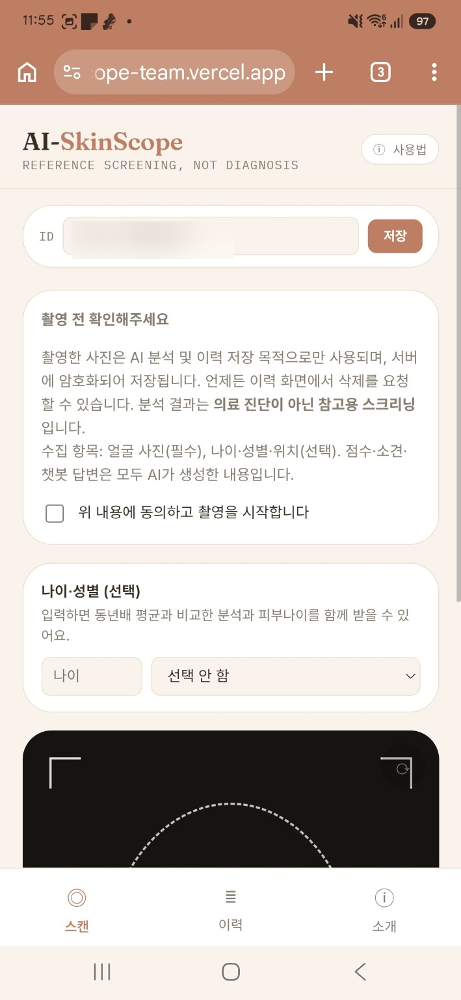
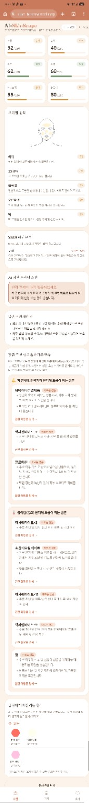
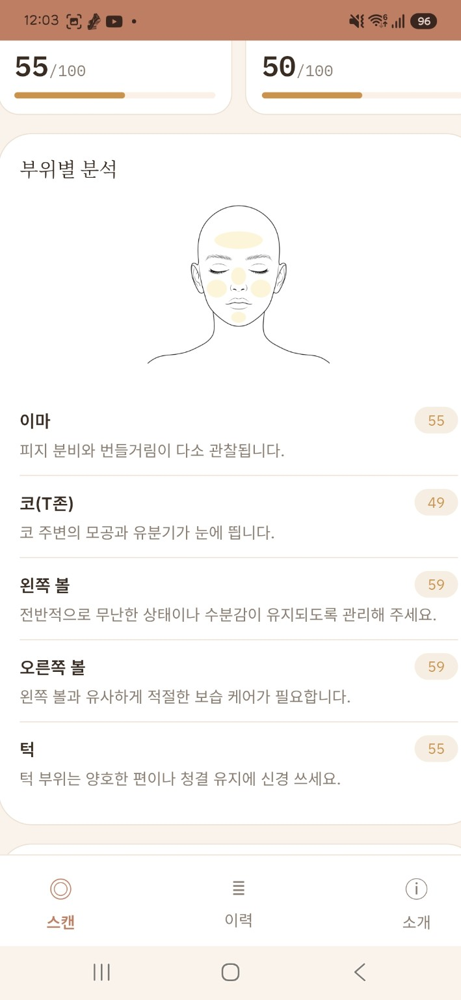
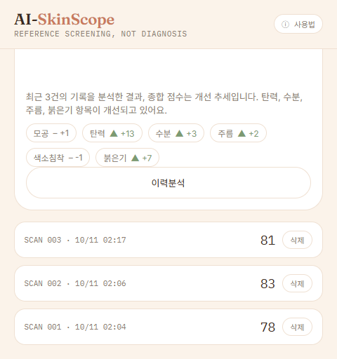

### 9-2. AI 활용 방식

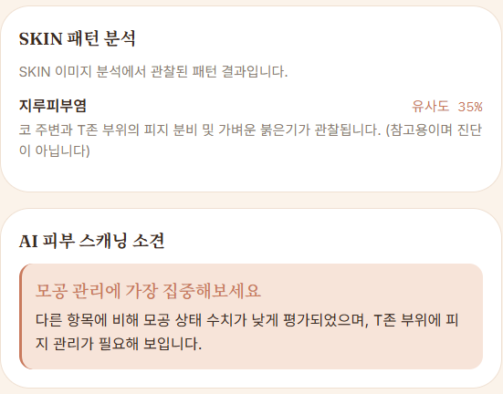
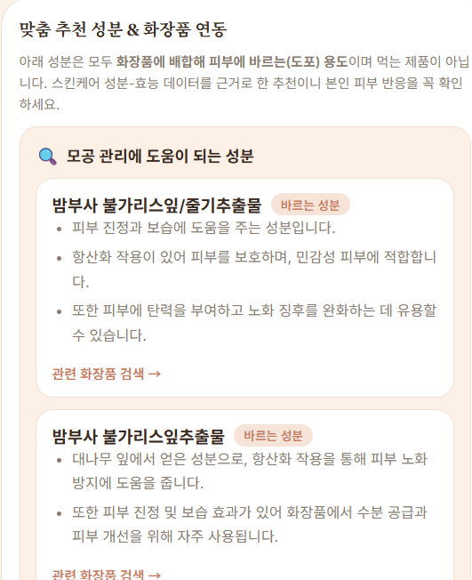
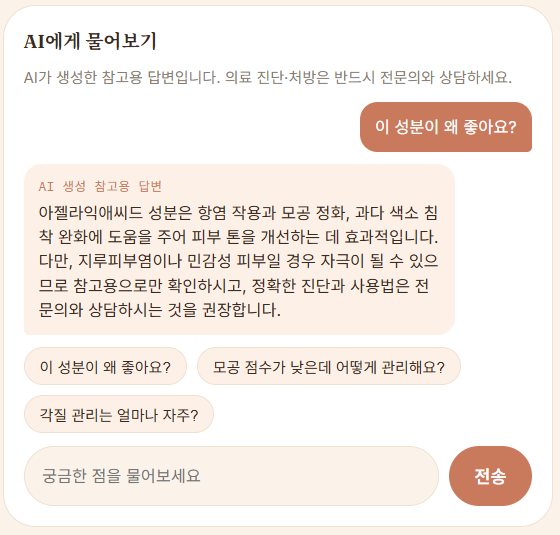
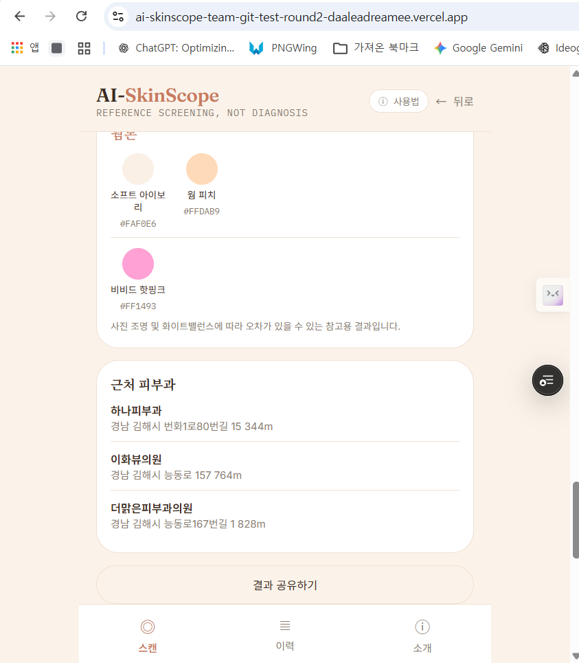

### 9-3. 사용자 피드백 및 개선

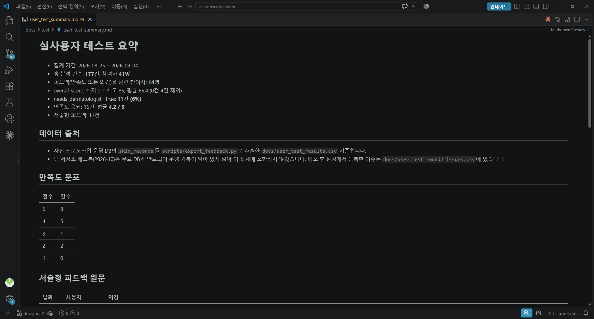
**피드백 반영 전후 예시** — 2026-08-25, 만족도 5점 의견:

> "얼굴 전체를 하나의 기준으로 분석하기보다 T존, 이마, 코, 양볼, 턱 등 부위별로 피부 상태를 나누어 분석하면 실제 피부 상태를 보다 정확하게 확인하는 데 도움이 될 것 같습니다."

→ 부위별 분석(FR-14)으로 반영: 이마·코(T존)·양볼·턱 5개 구역별 점수와 상태 설명 제공 (9-1절 3번 화면 [`screenshots/03.png`](screenshots/03.png)). 원문 전체는 [`test/user_test_summary.md`](test/user_test_summary.md)에 있습니다.

**배포 후 개선 전후 예시** — 잘못된 파일 업로드 안내 ([Issue #19](https://github.com/jjjoy1114/ai-skinscope/issues/19) → [PR #24](https://github.com/jjjoy1114/ai-skinscope/pull/24)):

- 전: 이미지가 아닌 파일을 올리면 기술 용어가 담긴 브라우저 알림창("…지원하지 않는 이미지 형식입니다: text/markdown")이 뜸 — 턴 7 배포 점검 5번, [`screenshots/process/T7-c5-2.png`](screenshots/process/T7-c5-2.png)
- 후: JPG·PNG만 선택되도록 제한하고, 화면 안에 "사진 파일(JPG, PNG)만 올릴 수 있어요" 안내 표시 — 턴 8 브라우저 QA, [`screenshots/process/T8-MK-4.png`](screenshots/process/T8-MK-4.png)

### 9-4. 협업 및 배포

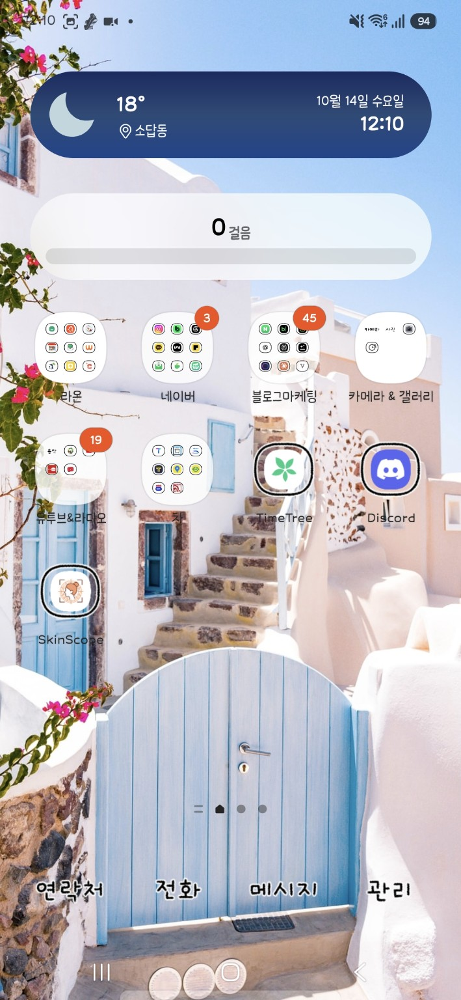
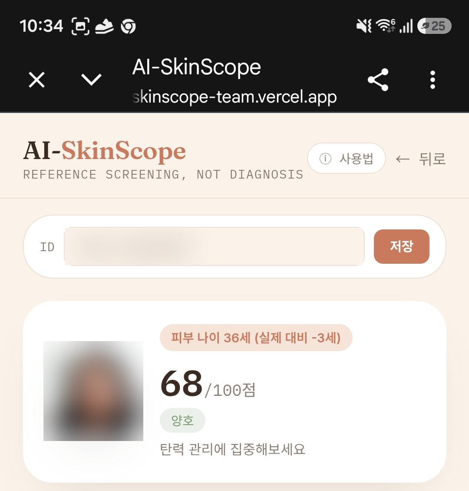
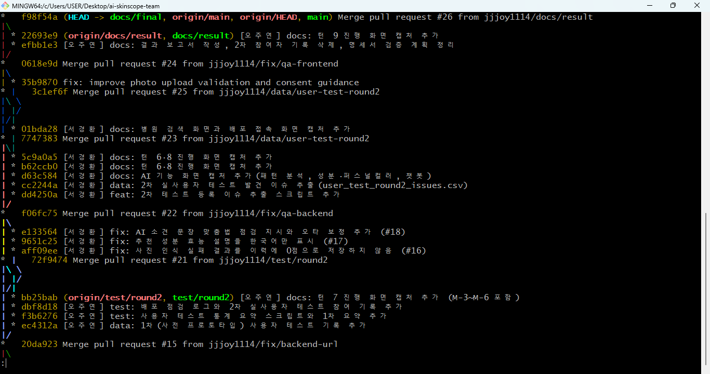
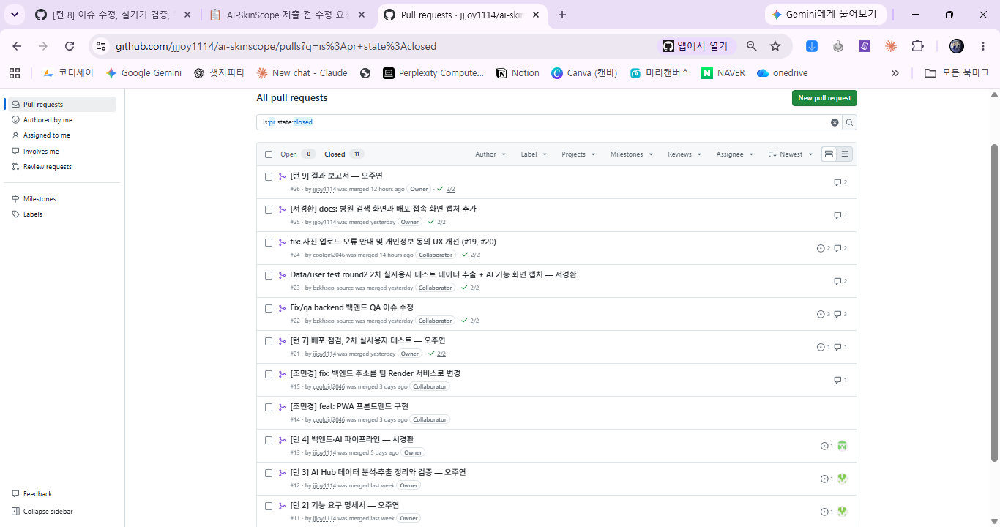
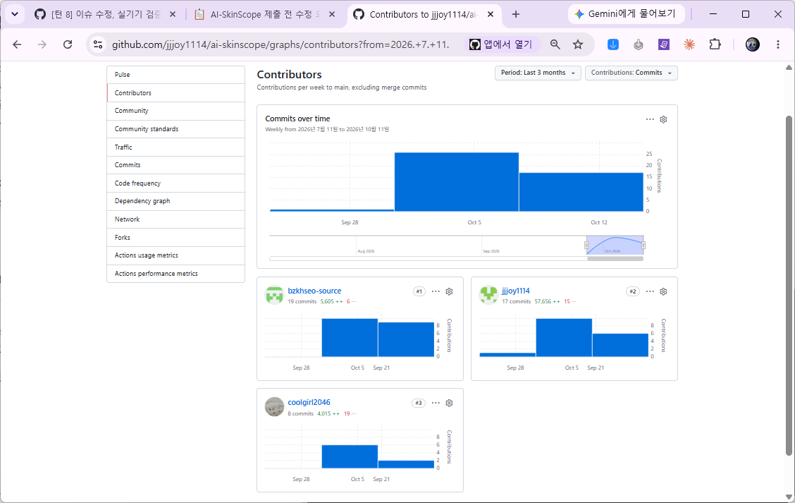
