# Must 기능 3회 검증 증빙 (턴 16)

턴 16 당시 Must 기능 10개(FR-01~10)를 3회씩 검증한 결과와, 판정 근거가 되는 사진·영상을 FR별로 정리했습니다.

> **10/19 명세 개정:** 운영 공지에 따라 Must를 워크플로우 **M1**(FR-02·01·03·04·05·07·10)과 **M2**(FR-08·09)로 통합하고, FR-06은 Should로 조정했습니다. 아래 FR별 기록은 워크플로우를 이루는 세부 단계의 증빙이며, FR-06 기록은 Should 기능의 동작 증빙으로 유지합니다.

- 관련 이슈: [#35](https://github.com/jjjoy1114/ai-skinscope/issues/35) · 상세 기록: [`docs/test/must_verification.md`](../must_verification.md)
- 판정 기준: [`기능요구명세서.md`](../../기능요구명세서.md) 10장의 **확인 방법·기대 결과**. 3회 중 2회 이상 기대 결과가 나오면 **충족**
- 사진: [`docs/test/captures/`](../captures/) 폴더의 24장 (성공 화면만)
- 영상: 이 폴더의 MP4 6개. 누르는 순서가 증거인 항목(FR-01, FR-02)과 결함 후보 1건. GitHub에서 파일을 누르면 내려받아 재생할 수 있습니다
- 개인정보: 명세서 4장 규칙에 따라 얼굴, 사용자 ID, 실제 나이를 계산할 수 있는 피부 나이 표시, 휴대폰 앨범 목록, 파일 이름은 흐림 처리했습니다 ('근처 피부과' 목록은 FR-06 증거라 그대로 둠)

## 회차 표기

| 표기 | 일시 | 내용 |
|---|---|---|
| 1회 · 2회 · 3회 | 10/16 16:30 · 16:33 · 16:35 | 같은 ID, 같은 배포 버전. 1회 사진 A, 2·3회 사진 B (3회는 화면에 남아 있던 사진 재분석) |
| V2 | 10/17 10:44 | 추가 검증: 카메라 촬영 → 분석 (화면이 갱신된 버전) |
| V3 | 10/17 | 추가 검증: 동의 절차 재확인 (동의 기록이 없는 크롬) |
| V4 | 10/18 13:17 | 리뷰 후 재검증: 피드백 전송 (본인 사진 D) |
| V5 | 10/18 13:19~13:20 | 리뷰 후 재검증: 56점, 전문의 상담 권고·근처 피부과, 피드백 전송 (사진 D, 위치 허용) |
| V6 | 10/18 13:22~13:23 | 리뷰 후 재검증: 62점, 전문의 상담 권고·근처 피부과, 패턴 "주사" (사진 D, 위치 허용) |

## 판정 요약

| FR | 기능 | 1회 | 2회 | 3회 | 추가 | 판정 |
|---|---|---|---|---|---|---|
| FR-01 | 사진 촬영/업로드 | ✅ | ✅ | ➖ | ✅ V2 | **충족** |
| FR-02 | 촬영 전 동의 | ✅ | ➖ | ➖ | ✅ V3 | **충족** |
| FR-03 | AI 이미지 분석 | ✅ | ✅ | ✅ | ✅ V2 | **충족** |
| FR-04 | 피부 건강 점수 | ✅ | ✅ | ✅ | ✅ V2 | **충족** |
| FR-05 | 유사 증상 패턴 안내 | ✅ | ✅ | ✅ | ✅ V2, V6 | **충족** |
| FR-06 | 전문의 상담 권장·병원 검색 | ⛔ | ⛔ | ⛔ | ⛔ V2 · ✅ V5, V6 | **충족** |
| FR-07 | 관리 코칭 메시지 | ✅ | ✅ | ✅ | ✅ V2, V6 | **충족** |
| FR-08 | 이력 저장 | ✅ | ✅ | ✅ | - | **충족** |
| FR-09 | 변화 추적 | ➖ | ✅ | ✅ | - | **충족** |
| FR-10 | 사용자 피드백 수집 | ✅ | ➖ | ➖ | ✅ V4, V5 | **충족** |

✅ 기대 결과 확인 / ❌ 기대 결과와 다름 / ➖ 해당 회차에서 동작을 수행하지 않음(성공 횟수에 포함하지 않음) / ⛔ 확인 조건(40점 이하 또는 AI 상담 필요 판단)이 나오지 않아 해당 없음

## FR별 검증과 증빙

### FR-01 사진 촬영/업로드 — 충족
- 기대 결과: 촬영 또는 갤러리 선택 → '이 사진으로 분석하기' → '분석 중...' 후 결과 화면 이동
- 1·2회 갤러리 업로드, V2 카메라 촬영 모두 결과 화면까지 이동 확인. 3회는 새 사진을 올리지 않아 제외

| 사진 | 검증 내용 |
|---|---|
| 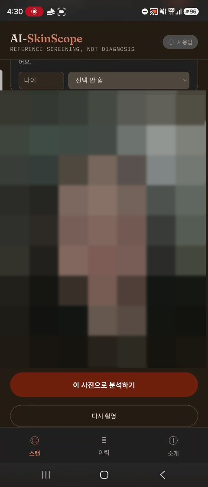 | `FR01_T1_upload.jpg` · 1회 갤러리 업로드 후 미리보기 |
| 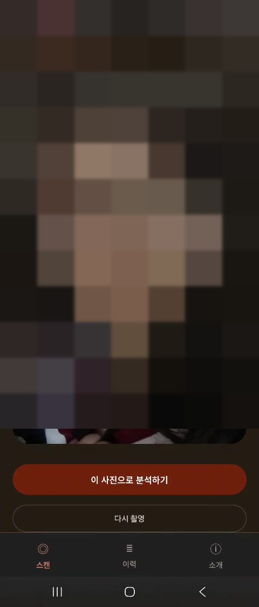 | `FR01_T2_upload.jpg` · 2회 갤러리 업로드 후 미리보기 |
| 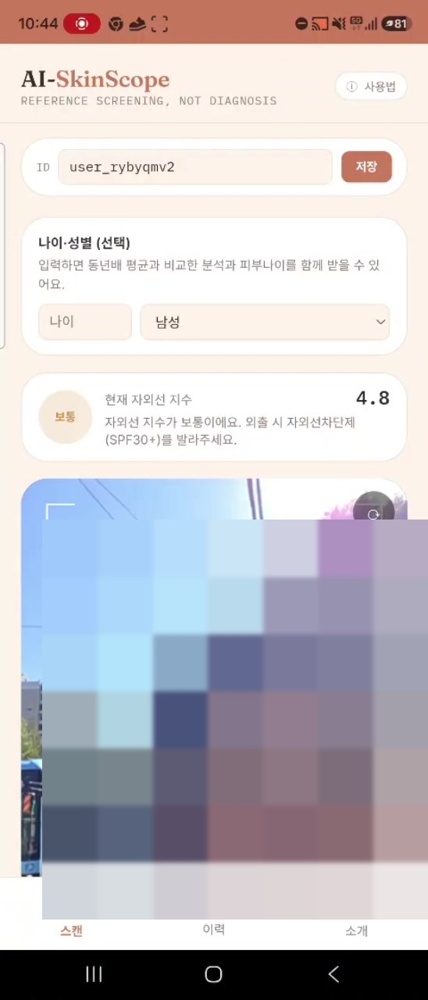 | `FR01_V2_camera_live.jpg` · V2 카메라 촬영 화면(타원 가이드) |
| 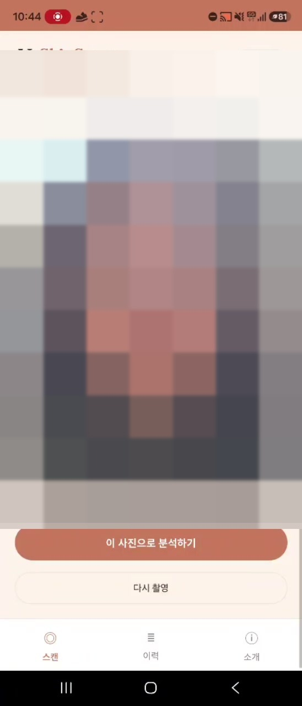 | `FR01_V2_camera_preview.jpg` · V2 촬영 후 미리보기 |

| 영상 | 검증 내용 |
|---|---|
| [T1_FR01_upload_result.mp4](T1_FR01_upload_result.mp4) | 1회 갤러리 업로드 → 분석 중 → 73점 결과 (분석 대기 구간 편집) |
| [C5_FR01_T2_upload.mp4](C5_FR01_T2_upload.mp4) | 2회 갤러리 업로드 → 미리보기 |
| [V2_FR01_camera_result.mp4](V2_FR01_camera_result.mp4) | 카메라 촬영 → 분석 → 75점 결과 (나이 입력 장면·대기 구간 편집) |

### FR-02 촬영 전 동의 — 충족
- 기대 결과: 동의 없이 '촬영' 또는 '갤러리에서 사진 선택'을 누르면 진행되지 않고 '동의해 주셔야 분석할 수 있어요' 표시
- 1회와 V3에서 확인. 2·3회는 동의 상태가 저장되어 동의 화면이 다시 나오지 않아 제외

| 사진 | 검증 내용 |
|---|---|
| 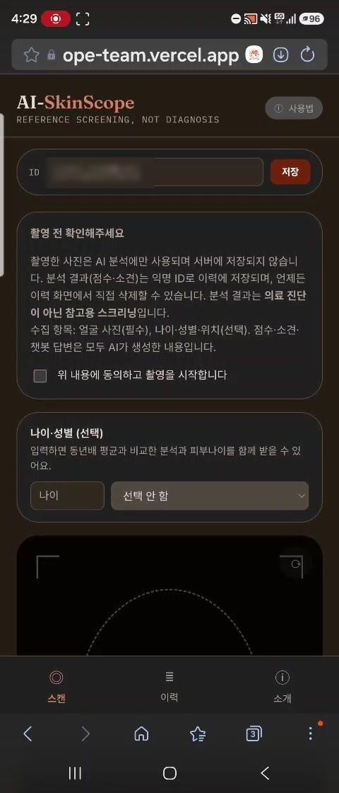 | `FR02_T1_consent.jpg` · 촬영 전 동의 안내(수집 항목·이용 목적·AI 생성 안내)와 체크박스 |
| 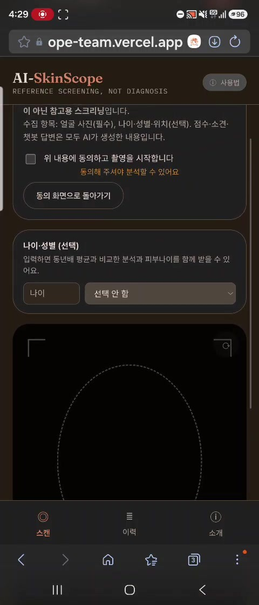 | `FR02_T1_block_unchecked.jpg` · 동의 없이 진행 시 "동의해 주셔야 분석할 수 있어요" |

| 영상 | 검증 내용 |
|---|---|
| [C1_FR02_consent_block.mp4](C1_FR02_consent_block.mp4) | 1회 동의 없이 갤러리 선택 → 차단 안내 → 동의 후 위치 권한 요청 |
| [V3_FR02_consent_retest.mp4](V3_FR02_consent_retest.mp4) | V3 동의 없이 촬영 버튼 반복 → 촬영 안 됨·안내 표시 → 체크 → 권한 요청 (다른 기기로 화면 촬영) |

### FR-03 AI 이미지 분석 · FR-04 피부 건강 점수 — 충족
- 기대 결과: 6개 항목(모공·탄력·수분·주름·색소침착·붉은기) 점수, 종합 점수(0~100)와 등급 배지 표시
- 4번 모두 확인. 등급 배지는 코드 기준(71~80점 "매우양호", 81점 이상 "백옥 피부 미녀(미남)")과 일치

| 사진 | 종합 | 등급 배지 | 모공 | 탄력 | 수분 | 주름 | 색소침착 | 붉은기 |
|---|---|---|---|---|---|---|---|---|
| 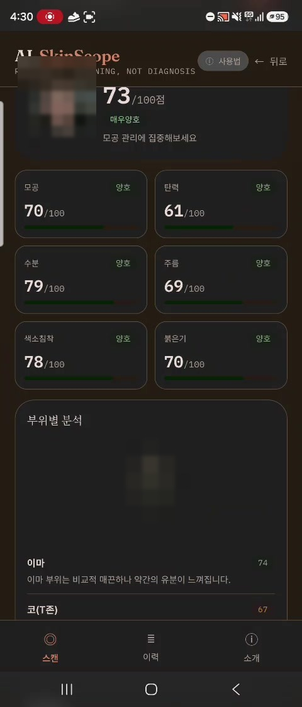 `FR03-04_T1_score_6items.jpg` · 1회 | 73 | 매우양호 | 70 | 61 | 79 | 69 | 78 | 70 |
| 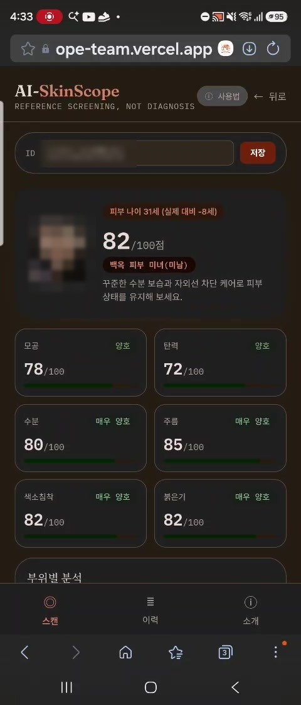 `FR03-04_T2_score_6items.jpg` · 2회 | 82 | 백옥 피부 미녀(미남) | 78 | 72 | 80 | 85 | 82 | 82 |
| 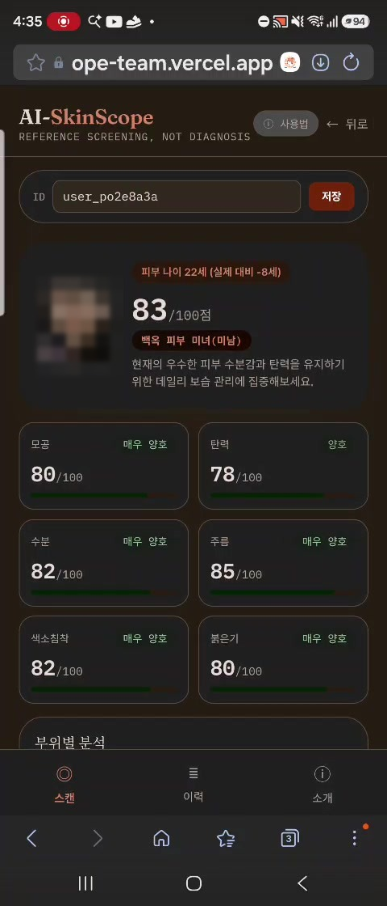 `FR03-04_T3_score_6items.jpg` · 3회 | 83 | 백옥 피부 미녀(미남) | 80 | 78 | 82 | 85 | 82 | 80 |
| 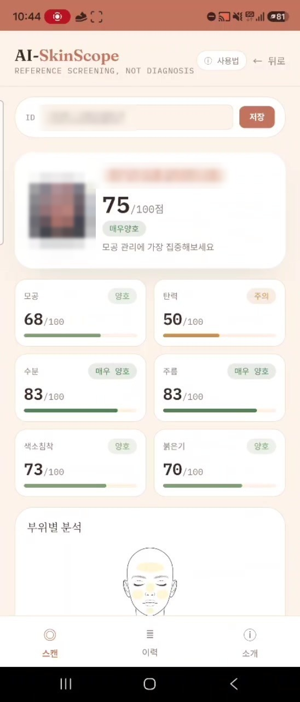 `FR03-04_V2_score_6items.jpg` · V2 | 75 | 매우양호 | 68 | 50 | 83 | 83 | 73 | 70 |

### FR-05 유사 증상 패턴 안내 — 충족
- 기대 결과(턴 16 보완): 'SKIN 패턴 분석' 카드에 유사 패턴 이름·유사도(%) 표시. 두드러진 패턴이 없으면 '특별히 두드러진 질환 패턴은 발견되지 않았습니다' 안내 표시. 화면에 진단이 아닌 참고용 스크리닝이라는 고지 포함
- 1회·V2·V6은 패턴 이름·유사도, 2·3회는 "두드러진 패턴 없음" 안내 표시 → 5번 모두 일치
- 고지: 모든 화면 상단 "REFERENCE SCREENING, NOT DIAGNOSIS"와 하단 "참고용 스크리닝 자료" 안내
- 턴 16 검증 중 명세 보완: 처음 기대 결과에는 패턴이 없을 때의 안내가 없어 2·3회를 ❌로 기록했으나, 팀 결정(PR #43 리뷰)에 따라 명세 10장에 추가하고 ✅로 바꿈

| 사진 | 검증 내용 |
|---|---|
| 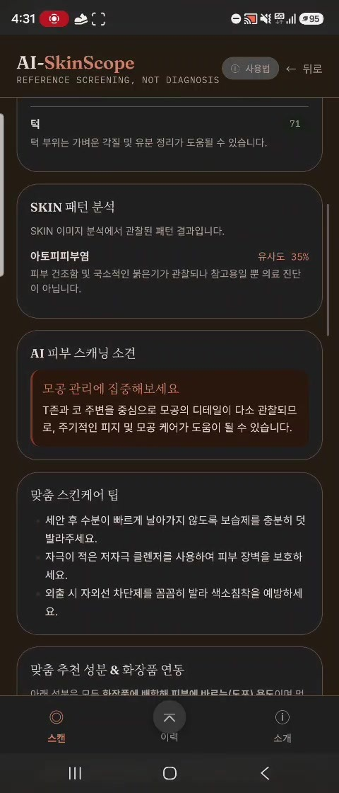 | `FR05-07_T1_pattern_tips.jpg` · 1회 "아토피피부염 유사도 35%" + 진단 아님 고지 |
| 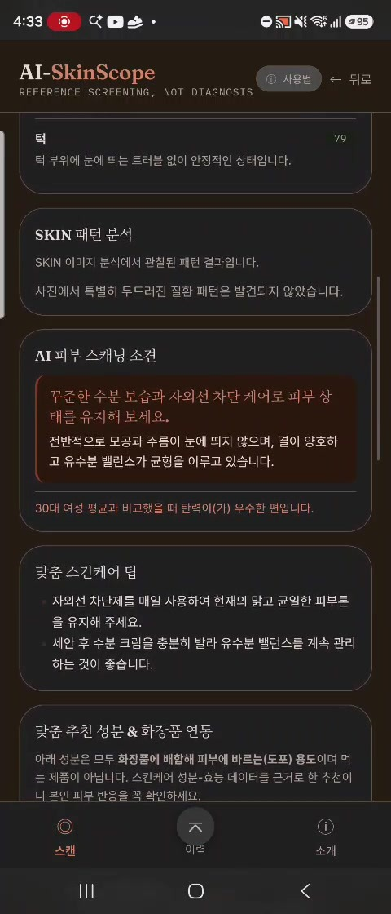 | `FR07_T2_tips.jpg` · 2회 "사진에서 특별히 두드러진 질환 패턴은 발견되지 않았습니다" (FR-07과 같은 화면) |
| 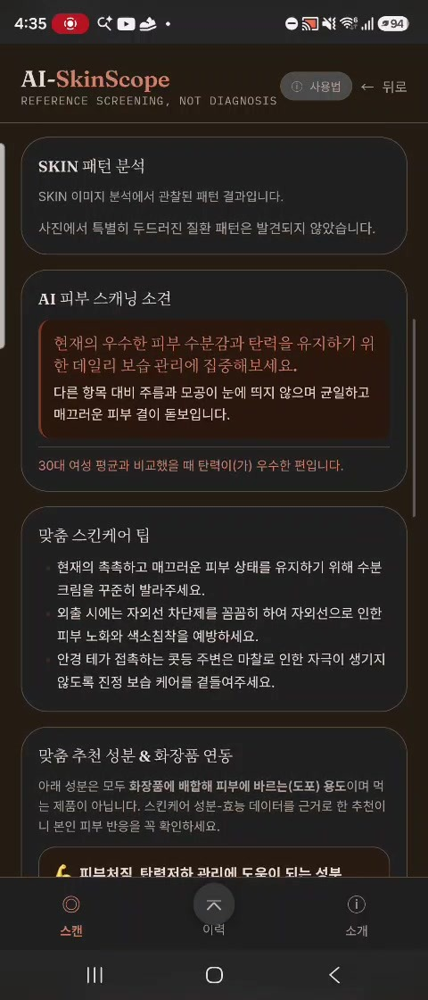 | `FR07_T3_tips.jpg` · 3회 같은 안내 (FR-07과 같은 화면) |
| 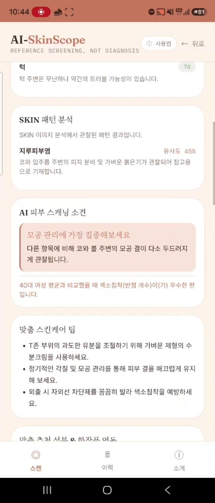 | `FR05-07_V2_pattern_tips.jpg` · V2 "지루피부염 유사도 45%" |
| 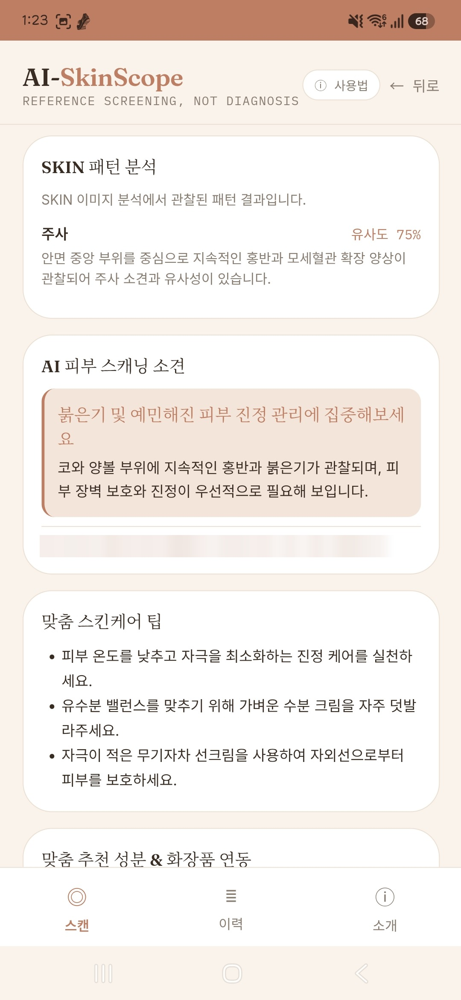 | `FR05-07_V6_pattern_tips.jpg` · V6 "주사 유사도 75%" + 근거 설명 |

### FR-06 전문의 상담 권장·병원 검색 — 충족
- 기대 결과: 종합 점수 40점 이하 또는 AI가 상담 필요로 판단하면 전문의 상담 권장 문구, 위치가 있으면 '근처 피부과' 목록
- 1~3회·V2는 73~83점이고 AI도 상담 필요로 판단하지 않아 확인 조건이 나오지 않음(해당 없음)
- V5(56점)·V6(62점)에서 "피부과 전문의 진료 권고" 배지, "전문의 상담을 권장드려요. 가까운 피부과 방문을 고려해보세요.", '근처 피부과' 4곳 표시 → 2번 모두 기대 결과와 일치
- 두 번 모두 40점보다 높으므로 "AI가 상담 필요로 판단" 조건으로 나온 결과로 보임
- 결과 하단의 "피부과 전문의와 상담하시기 바랍니다"는 모든 결과에 나오는 고정 안내문이라 증거로 세지 않음

| 사진 | 검증 내용 |
|---|---|
| 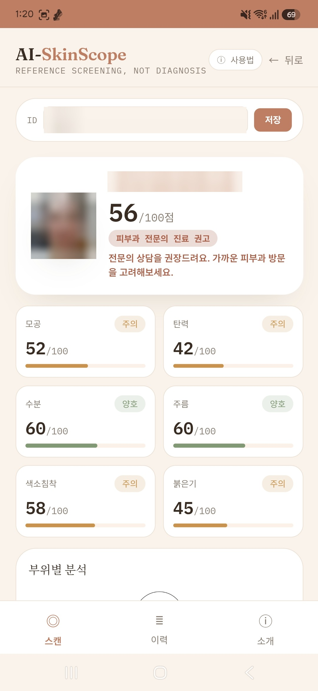 | `FR06_V5_dermatologist_advice.jpg` · V5 56점, 피부과 전문의 진료 권고와 상담 권장 문구 |
| 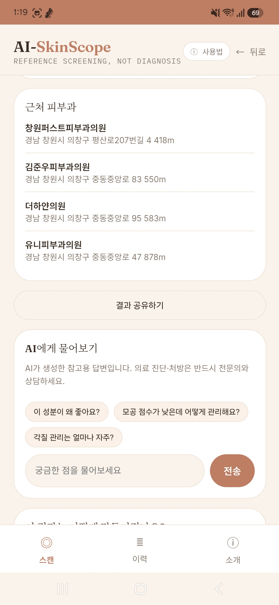 | `FR06_V5_nearby_clinics.jpg` · V5 '근처 피부과' 4곳 |
|  | `FR06_V6_dermatologist_advice.jpg` · V6 62점, 피부과 전문의 진료 권고와 상담 권장 문구 |
| 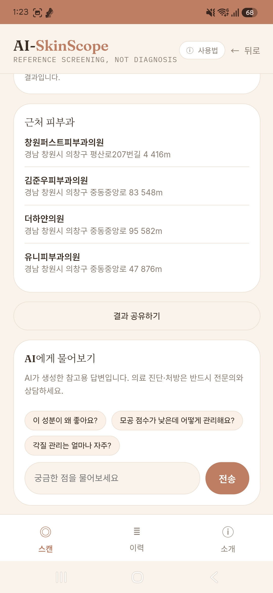 | `FR06_V6_nearby_clinics.jpg` · V6 '근처 피부과' 4곳 |

### FR-07 관리 코칭 메시지 — 충족
- 기대 결과: '맞춤 스킨케어 팁' 카드에 분석 결과에 맞는 관리 팁 표시
- 1~3회·V2·V6 모두 확인. 결과에 따라 소견과 팁 내용이 달라짐(예: 1회·V2 소견 "모공 관리에 집중해보세요", 2회 "꾸준한 수분 보습과 자외선 차단 케어", 3회 "데일리 보습 관리", V6 "붉은기 및 예민해진 피부 진정 관리에 집중해보세요")

| 사진 | 검증 내용 |
|---|---|
|  | `FR05-07_T1_pattern_tips.jpg` · 1회 맞춤 스킨케어 팁 (FR-05와 같은 화면) |
|  | `FR07_T2_tips.jpg` · 2회 맞춤 스킨케어 팁 |
|  | `FR07_T3_tips.jpg` · 3회 맞춤 스킨케어 팁 |
|  | `FR05-07_V2_pattern_tips.jpg` · V2 맞춤 스킨케어 팁 (FR-05와 같은 화면) |
|  | `FR05-07_V6_pattern_tips.jpg` · V6 진정 관리 소견과 맞춤 스킨케어 팁 (FR-05와 같은 화면) |

### FR-08 이력 저장 · FR-09 변화 추적 — 충족
- FR-08 기대 결과: '이력' 탭에 방금 기록이 날짜·점수와 함께 표시 → 2회 후 2건, 3회 후 3건으로 3번 모두 저장 확인
- FR-09 기대 결과: 같은 ID로 2회 이상 분석 후 TREND 배너에 직전 기록 대비 점수 변화 → 2회 +9, 3회 +1 확인 (1회는 비교할 기록 없음)
- 참고: 3회는 2회와 같은 사진이라 실제 피부 변화를 보여주는 사례는 아님

| 사진 | 검증 내용 |
|---|---|
| 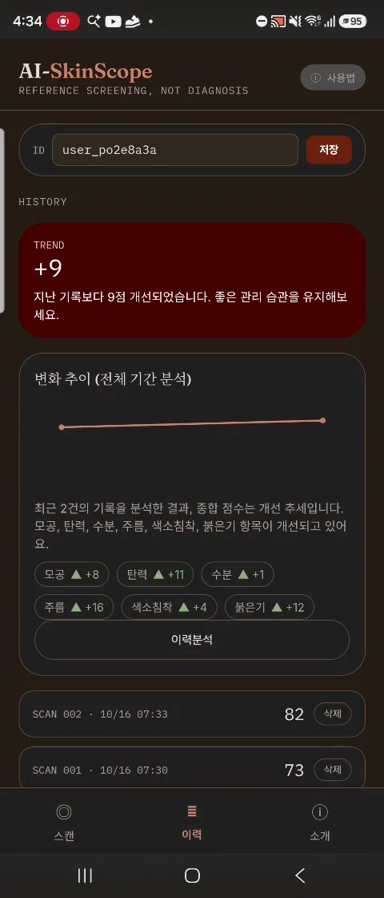 | `FR08-09_after_T2_history.jpg` · 2회 후 이력 2건(73·82점), TREND +9 |
| 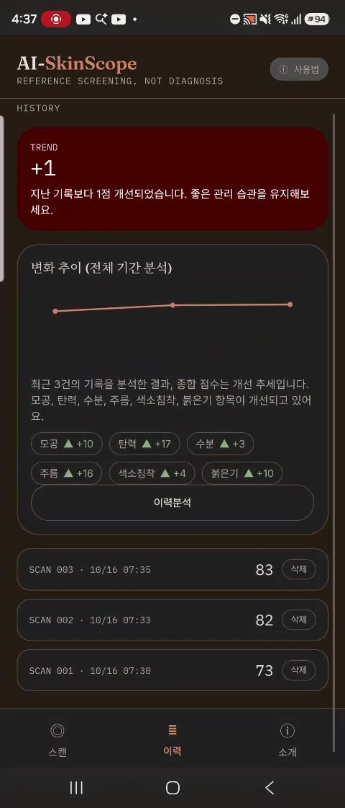 | `FR08-09_after_T3_history.jpg` · 3회 후 이력 3건(73·82·83점), TREND +1 |

### FR-10 사용자 피드백 수집 — 충족
- 기대 결과: 1~5점 선택 → '피드백 보내기' → "소중한 의견 감사합니다!" 표시
- 1회·V4·V5에서 확인. 2·3회는 피드백을 보내지 않아 기록 없음(실패 아님)

| 사진 | 검증 내용 |
|---|---|
| 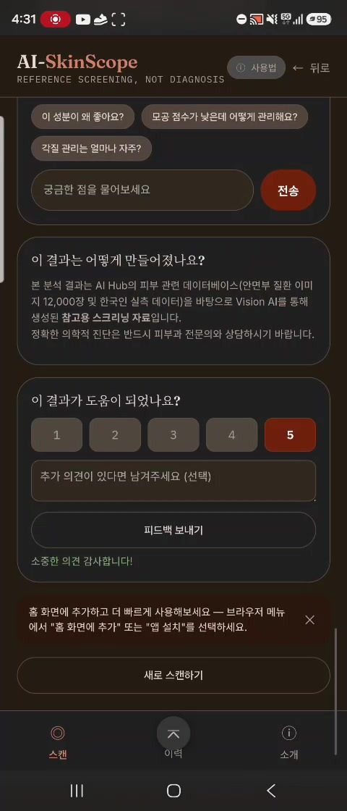 | `FR10_T1_feedback_sent.jpg` · 1회 5점 전송 → "소중한 의견 감사합니다!" |
| 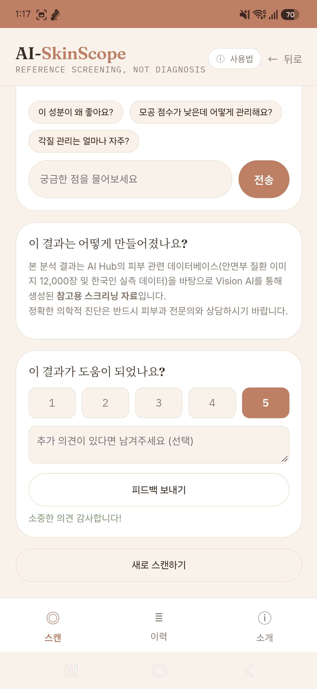 | `FR10_V4_feedback_sent.jpg` · V4 5점 전송 → "소중한 의견 감사합니다!" |
| 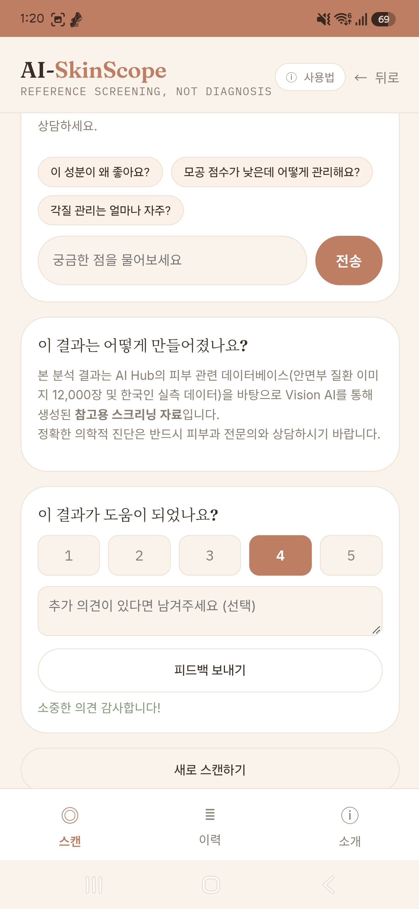 | `FR10_V5_feedback_sent.jpg` · V5 4점 전송 → "소중한 의견 감사합니다!" |

## 결함 후보 영상

| 영상 | 검증 내용 |
|---|---|
| [D5_photo_retained.mp4](D5_photo_retained.mp4) | 이력 탭 → 스캔 탭으로 돌아오면 직전 사진이 남아 있고, 새 사진 없이 나이만 바꿔 재분석됨 (FR-01·08·09 관련, 상세는 `must_verification.md` 5장) |
